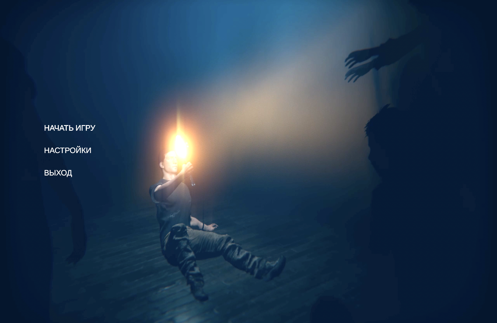
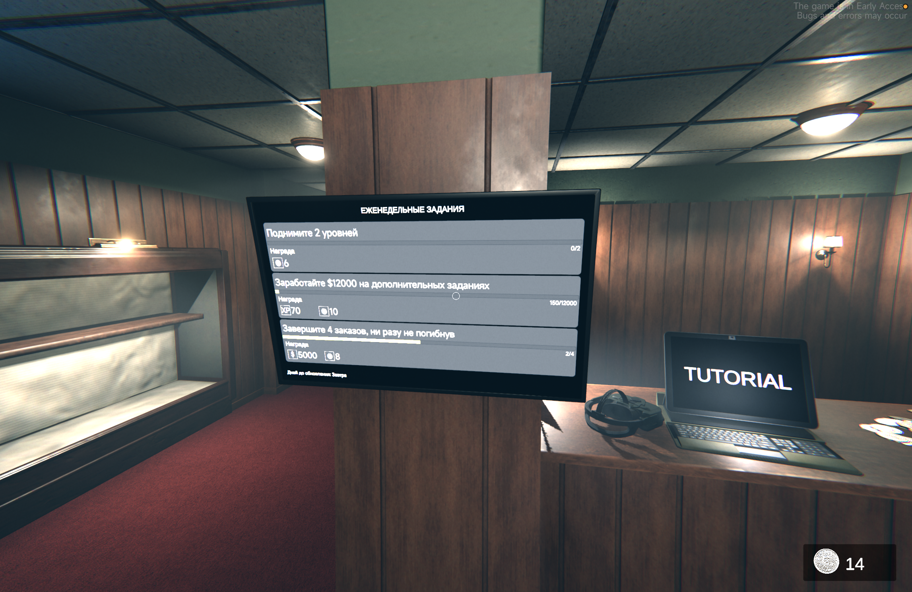
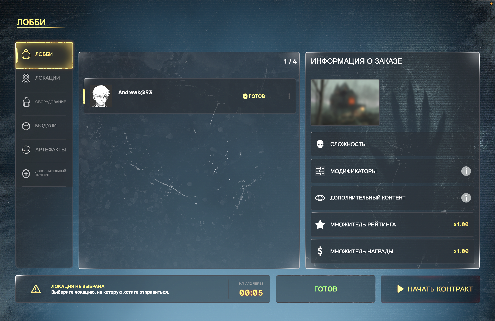
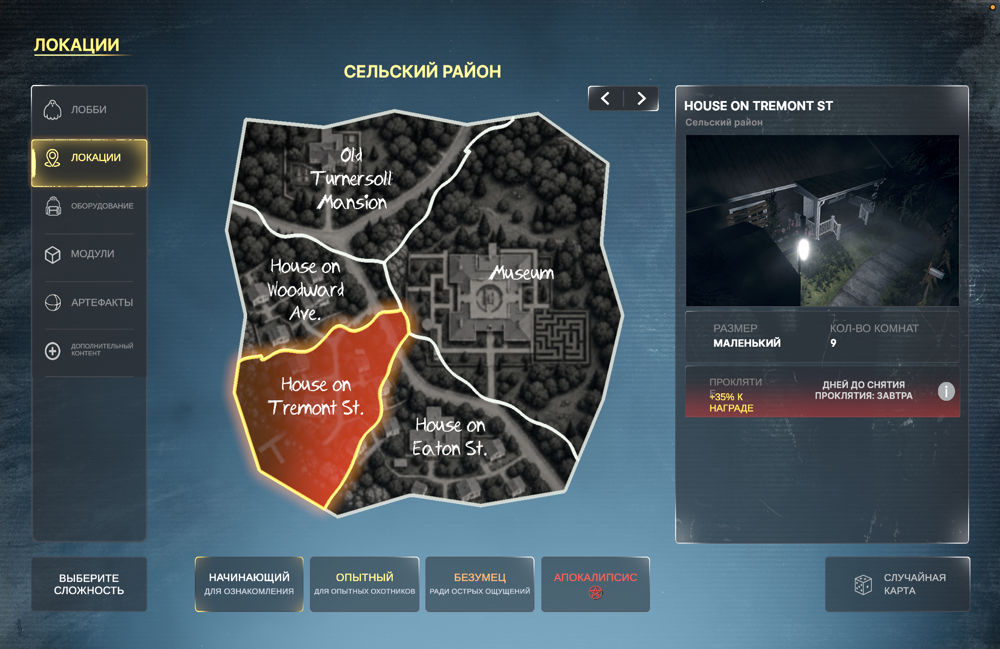

<h1 align="center">Game Locale</h1>

<b>Русский язык и озвучка игр на Mac</b> CrossOver · GameHub

<a href="#игры">Игры</a> · <a href="#как-пользоваться">Как пользоваться</a> · <a href="#история-версий">История версий</a> · <a href="#авторские-права">Авторские права</a>

GameLocale помогает включить русский язык в Ghost Exile и установить русскую озвучку Phasmophobia. Выбери игру на главном экране — внутри её карточки находятся доступные действия и информация о переводе.

> **GameLocale 3.0 готовится к выпуску.** Исходный проект уже обновлён. Готовая установочная сборка 3.0 ещё не опубликована.
>
> Нужна прежняя версия для Ghost Exile? [Архивный релиз 2.0](https://github.com/TechnologyUniverse/GameLocale/releases/tag/v2.0) остаётся доступен. Озвучки Phasmophobia в нём нет.

## Игры

<table><tr><td width="50%"></td><td width="50%"></td></tr></table>

| Игра | Возможности | Состояние |
| --- | --- | --- |
| **Ghost Exile** | Включение русского интерфейса и реплик ритуалов | Работа подтверждена пользователем в CrossOver и GameHub |
| **Phasmophobia** | Установка 226 русских голосовых записей с эффектами; возврат оригиналов | Озвучка **0.1 beta**, продолжается проверка в игре |

## Phasmophobia — русская озвучка 0.1 beta

В пакет входят реплики диктора, ответы Spirit Box, голоса параболического микрофона, кукол и гномов, радиозаписи и реплики телевизора события. Используется мужской голос с обработкой под разные типы записей.

- **226 записей**: 56 реплик диктора и 170 новых переводов и адаптаций.
- **12 записей содержат атмосферную адаптацию** неразборчивых слов; это не буквальная расшифровка.
- Оригинальные звуковые эффекты, дыхание, крики и музыка без различимой речи сохраняются.
- Пакет рассчитан на **Steam-сборку 25811160**. При несовместимых файлах установка останавливается.

Работу прежних 56 реплик диктора пользователь подтвердил в игре. Новые записи требуют полного игрового прогона. Установка расширенного пакета проверена в локальной CrossOver-версии; отдельный прогон нового пакета в GameHub ещё не выполнен. Нативная поддержка игр запланирована для будущих версий.

## Как пользоваться

1. Установи приложение из подходящего релиза и открой **GameLocale**.
2. Выбери игру: **Ghost Exile** или **Phasmophobia**.
3. Закрой игру и выйди из Steam.
4. Выбери найденную установку или укажи папку вручную.
5. Для Ghost Exile нажми **«Включить русский»**, для Phasmophobia — **«Установить русскую озвучку»**.
6. Запусти игру и проверь результат.

Приложение сохраняет резервные копии изменяемых файлов. В Phasmophobia кнопка **«Вернуть оригинал»** восстанавливает исходную озвучку. После обновления игры совместимость пакета нужно проверить заново.

## Что нового в 3.0

- Общее приложение **GameLocale** с отдельными карточками игр.
- Сохранён функционал Ghost Exile для CrossOver и GameHub.
- Добавлена русская озвучка Phasmophobia **0.1 beta**.
- Для Phasmophobia доступны прослушивание примера, установка и возврат оригинала.
- Новые обложки, оформление и понятные статусы переводов.

Версия приложения и версия озвучки независимы: **GameLocale 3.0** и **Phasmophobia RU 0.1 beta**.

## История версий

| Версия | Изменения |
| --- | --- |
| **3.0 — готовится** | GameLocale, библиотека игр и Phasmophobia RU 0.1 beta |
| **2.0** | Приложение Ghost Exile RU для macOS; русский интерфейс и ритуалы Ghost Exile |

Релиз 2.0 сохраняется в истории для пользователей прежнего приложения.

## Ghost Exile на русском

Пользователь подтвердил работу русского интерфейса и реплик ритуалов через CrossOver и GameHub. Скриншоты сделаны в игре после применения локализации.

<table>
<tr><td width="50%"><b>Главное меню</b> </td><td width="50%"><b>Задания</b> </td></tr>
<tr><td><b>Лобби и контракт</b> </td><td><b>Локации и сложность</b> </td></tr>
</table>

## Авторские права

© 2026 Technology Universe. Все права на оригинальный код сохранены.

Приложение можно скачивать и запускать для личного использования. Для перепубликации, распространения изменённых версий и включения кода в сторонние проекты требуется письменное разрешение правообладателя, за исключением случаев, предусмотренных законом или условиями GitHub.

Ghost Exile, Phasmophobia, названия, логотипы и исходные материалы игр принадлежат их правообладателям. GameLocale — независимый неофициальный проект. Права на игры и их материалы не передаются автору GameLocale. Компоненты сторонних разработчиков используются на условиях их лицензий.

## Официальные страницы игр

- [Ghost Exile в Steam](https://store.steampowered.com/app/1807080/)
- [Phasmophobia в Steam](https://store.steampowered.com/app/739630/)
