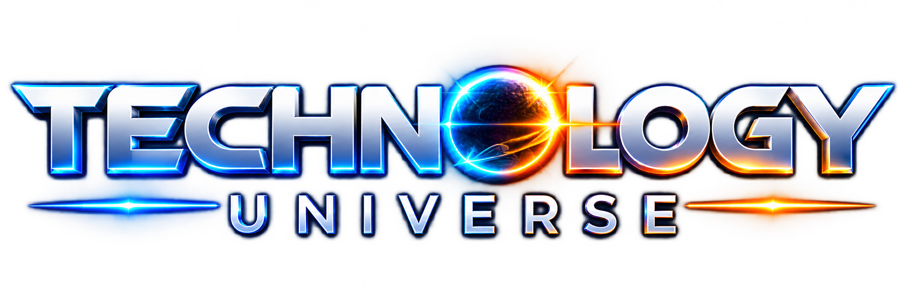
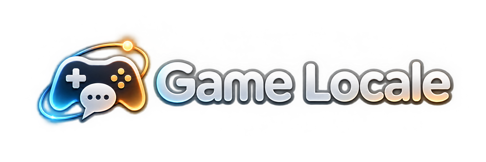
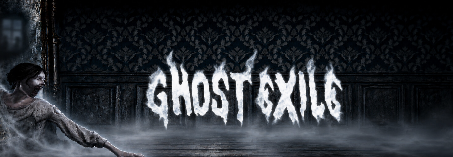
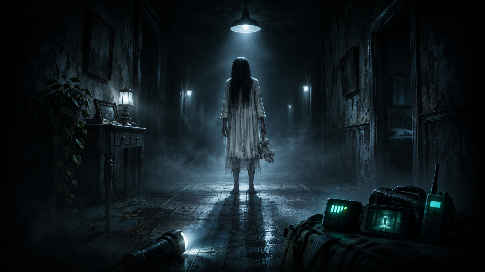
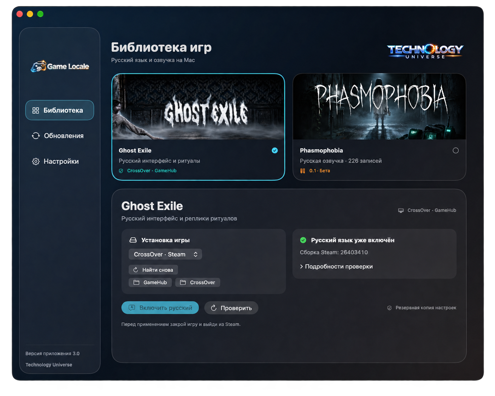
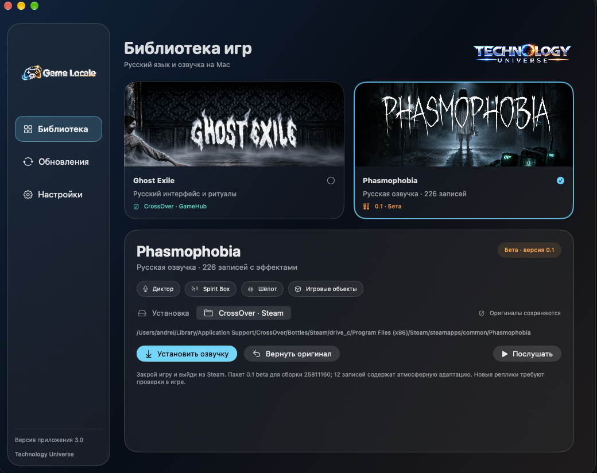

<h1 align="center">Game Locale</h1>

<b>Агрегатор для установки русской озвучки игр на Mac и Windows</b> Steam · CrossOver · GameHub

<a href="#игры-в-версии-30">Поддерживаемые игры</a> · <a href="#история-версий">История версий</a> · <a href="#авторские-права">Авторские права</a>

**Game Locale** объединяет игровые локализации в одной библиотеке. Выбери игру, чтобы узнать, какая русская озвучка доступна для твоей платформы. Для поддерживаемых пакетов приложение помогает найти установку игры, применить озвучку и при необходимости восстановить оригинальные файлы.

<a href="https://github.com/TechnologyUniverse/GameLocale/releases/download/v3.0/Game-Locale-3.0-Apple-Silicon.dmg"><b>⬇ Скачать для Mac (.dmg)</b></a> · <a href="https://github.com/TechnologyUniverse/GameLocale/releases/download/v3.0/Game-Locale-3.0-Windows-x64.exe"><b>⬇ Скачать для Windows x64 (.exe)</b></a> <a href="https://github.com/TechnologyUniverse/GameLocale/releases/tag/v3.0">Что нового в релизе</a>

| Платформа | Требования |
| --- | --- |
| **Mac** | Apple Silicon (M1 и новее), macOS 14+, Steam через CrossOver или GameHub |
| **Windows** | Windows 11 x64, установленная игра в Steam |

## ✨ Что нового в 3.0

| | В этом выпуске |
| --- | --- |
| 🫧 **Новый облик** | Стеклянный интерфейс, карточки игр и удобное переключение функций |
| 👻 **Ghost Exile** | Русский интерфейс и ритуалы через CrossOver и GameHub |
| 🎙 **Phasmophobia** | 226 русских записей с эффектами · озвучка **0.1 beta** |
| ↩️ **Управление озвучкой** | Прослушивание, установка и возврат оригиналов |
| 💻 **Две платформы** | DMG для Mac с Apple Silicon и EXE для Windows x64 |

[Все изменения и особенности бета-озвучки →](https://github.com/TechnologyUniverse/GameLocale/releases/tag/v3.0)

## Установка

### Mac

1. Скачай **Game-Locale-3.0-Apple-Silicon.dmg** по кнопке выше.
2. Открой образ и перетащи **GameLocale** в **Applications («Программы»)**.
3. Запусти приложение из папки «Программы».

### Windows

1. Скачай **Game-Locale-3.0-Windows-x64.exe** и запусти установщик.
2. Открой **Game Locale** из меню «Пуск».
3. Выбери **Phasmophobia**. Приложение ищет игру в библиотеках Steam. Папку также можно указать вручную.

Установщик Windows пока без цифровой подписи. Windows может показать предупреждение об издателе.

Версия 3.0 устанавливается вручную. Обновления macOS через Sparkle планируются со следующей версии.

[Архивный Ghost Exile RU 2.0](https://github.com/TechnologyUniverse/GameLocale/releases/tag/v2.0) остаётся доступен; озвучки Phasmophobia в нём нет.

## Игры в версии 3.0

Здесь перечислены локализации, доступные в текущей версии Game Locale. Каталог рассчитан на добавление новых игр.

<table><tr><td width="50%"></td><td width="50%"></td></tr></table>

| Игра | Возможности | Состояние |
| --- | --- | --- |
| **Ghost Exile** | На Mac приложение включает русский интерфейс и реплики ритуалов. На Windows они доступны в самой игре | Mac: проверено в CrossOver и GameHub |
| **Phasmophobia** | Установка 226 русских голосовых записей с эффектами; возврат оригиналов | **0.1 beta · проверена в игре на Mac и Windows** |

## Phasmophobia — русская озвучка 0.1 beta

В пакет входят реплики диктора, ответы Spirit Box, голоса параболического микрофона, кукол и гномов, радиозаписи и реплики телевизора события. В бета-версии используется один мужской голос с обработкой под разные типы записей. Отдельные голоса диктора, призраков и игровых объектов запланированы на будущее.

- **226 записей**: 56 реплик диктора и 170 новых переводов и адаптаций.
- **12 записей содержат атмосферную адаптацию** неразборчивых слов; это не буквальная расшифровка.
- Оригинальные звуковые эффекты, дыхание, крики и музыка без различимой речи сохраняются.
- Пакет рассчитан на **Steam-сборку 25811160**. При несовместимых файлах установка останавливается.

> ✅ **Проверка в игре пройдена.** Пользователь подтвердил, что русская озвучка **0.1 beta** работает на Mac и Windows.

## История версий

| Версия | Изменения |
| --- | --- |
| **3.0 — 5 ноября 2026** | Game Locale для Mac и Windows, библиотека игр и Phasmophobia RU 0.1 beta |
| **2.0 — архив** | Приложение Ghost Exile RU для macOS; русский интерфейс и ритуалы Ghost Exile |

Релиз 2.0 сохраняется в истории для пользователей прежнего приложения.

## Как выглядит приложение

**Одна библиотека — функции выбранной игры под рукой.**

### Ghost Exile · русский интерфейс и ритуалы

Поиск установки, проверка языка и включение русификации через CrossOver или GameHub.

### Phasmophobia · русская озвучка 0.1 beta

226 записей с эффектами. Прослушай пример, установи озвучку или верни оригинал.

## Авторские права

© 2026 Technology Universe. Все права на оригинальный код сохранены.

Приложение можно скачивать и запускать для личного использования. Для перепубликации, распространения изменённых версий и включения кода в сторонние проекты требуется письменное разрешение правообладателя, за исключением случаев, предусмотренных законом или условиями GitHub.

Ghost Exile, Phasmophobia, названия, логотипы и исходные материалы игр принадлежат их правообладателям. GameLocale — независимый неофициальный проект. Права на игры и их материалы не передаются автору GameLocale. Компоненты сторонних разработчиков используются на условиях их лицензий.

## Официальные страницы игр

- [Ghost Exile в Steam](https://store.steampowered.com/app/1807080/)
- [Phasmophobia в Steam](https://store.steampowered.com/app/739630/)
